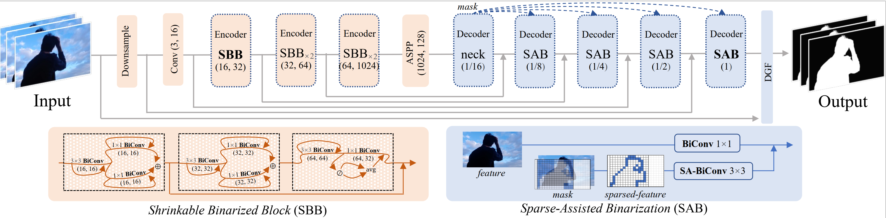

# BiMatting: Efficient Video Matting via Binarization

**NeurIPS 2023**

Haotong Qin, Lei Ke, Xudong Ma, Martin Danelljan, Yu-Wing Tai, Chi-Keung Tang, Xianglong Liu, Fisher Yu

[Published paper](https://proceedings.neurips.cc/paper_files/paper/2023/hash/86c070ce724102ee876d1935590e111a-Abstract-Conference.html) | [OpenReview](https://openreview.net/forum?id=YbYQ0JEQ80) | [Citation](#citation)

**BiMatting reduces the cost of video matting with a 1-bit network, using a Shrinkable Binarized Block (SBB) to strengthen the encoder and Sparse-Assisted Binarization (SAB) to reduce redundant decoder computation.** It is a trained video-matting model, requiring the data and training pipeline described in Section 3.4.

## Published results

VM at **512×288** from Table 2. Alpha MAD/MSE are lower-is-better. The reported FLOPs use the paper's binary-operation accounting; model size is parameter storage, not runtime memory.

| Method | Bits | FLOPs (G) | Model size (MB) | Alpha MAD | Alpha MSE |
| --- | --- | --- | --- | --- | --- |
| RVM (oracle) | 32 | 4.57 | 14.50 | 6.08 | 1.47 |
| RVM-DoReFa | 1 | 0.52 | 0.57 | 51.64 | 34.50 |
| RVM-ReAct | 1 | 0.55 | 0.64 | 28.49 | 18.16 |
| BiMatting | 1 | 0.37 | 0.67 | 12.82 | 6.65 |

The **12.4× computation and 21.6× storage savings** compare BiMatting with RVM under this accounting; they are not measured wall-clock speedups. BiMatting improves over the binary baselines but still has a numerical accuracy gap to the full-precision RVM oracle.

### What this paper supports

- Direct binarization encounters encoder representation degradation and redundant decoding computation (Section 3.1).
- SBB improves the binarized encoder through the proposed dense/shrinkable block design (Section 3.2; Table 1).
- SAB reduces low-information decoder computation through sparsity (Section 3.3; Table 1).
- The proposed design improves alpha-matting accuracy over the evaluated 1-bit baselines across VM, D646, and AIM (Table 2).
- High-resolution performance is evaluated separately, including VM at 1920×1080 (Table 3); the low-resolution efficiency numbers above should not be transferred to another resolution.



## Dependencies

```bash
# Go to the default directory
pip install -r requirements.txt
```

## Execution

```bash
# We provide script to train and test our model
sh scripts/train.sh
sh scripts/test.sh
```

## Repository training-stage records

The following table is retained from the original code release, including its original `VM512x512` label and foreground entries. It is a historical training-stage record, not a transcription of Table 2. Use the published table above for paper-level comparisons; the `paper` row below also differs from the final Table 3 (for example VM dtSSD is 3.25 in the final paper).

|        | VM512x512 |         |          |          |           |         |         | VM1920x1080 |         |          |            |
|--------|-----------|---------|----------|----------|-----------|---------|---------|-------------|---------|----------|------------|
|        | pha_mad   | pha_mse | pha_grad | pha_conn | pha_dtssd | fgr_mad | fgr_mse | pha_mad     | pha_mse | pha_grad | pha_dtssd  |
| stage1 | 15.06     | 8.75    | 2.83     | 1.76     | 2.70      | 42.46   | 14.81   | 19.33       | 11.63   | 27.73    | 3.42       |
| stage2 | 13.50     | 7.02    | 3.32     | 1.52     | 2.69      | 46.28   | 15.39   | 19.68       | 11.80   | 29.64    | 3.39       |
| stage3 | 12.67     | 6.89    | 2.78     | 1.40     | 2.65      | 39.07   | 13.30   | 17.95       | 11.41   | 22.13    | 3.18       |
| stage4 | 12.82     | **6.65**    | **2.97**     | **1.42**     | **2.69**      | **363.69**  | **213.77**  | **17.71**       | **10.79**   | 22.10    | 3.24       |
| paper  | 12.82     | 6.65    | 2.97     | 1.42     | 2.69      | 363.69  | 213.77  | 18.16       | 11.15   | 21.90    | 2.25       |


## Citation

Please cite the published paper below. Open paper versions are linked at the top of this README.

```bibtex
@inproceedings{qin2023bimatting,
  title = {{BiMatting}: Efficient Video Matting via Binarization},
  author = {Haotong Qin and Lei Ke and Xudong Ma and Martin Danelljan and Yu-Wing Tai and Chi-Keung Tang and Xianglong Liu and Fisher Yu},
  booktitle = {Advances in Neural Information Processing Systems},
  year = {2023},
  volume = {36},
  url = {https://proceedings.neurips.cc/paper_files/paper/2023/hash/86c070ce724102ee876d1935590e111a-Abstract-Conference.html}
}
```
